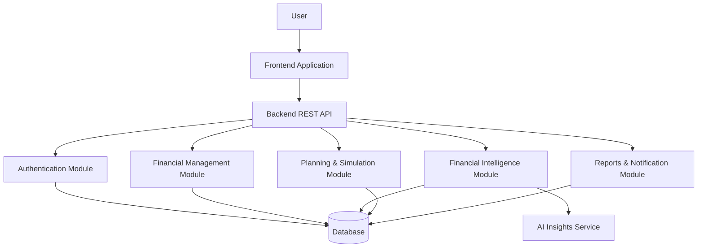
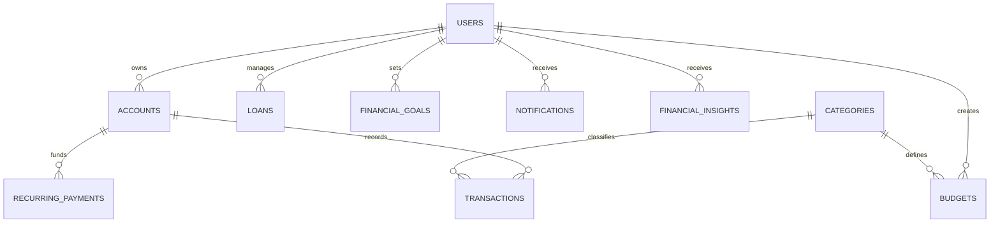

# 💠 SYNTRA
### Smart Personal Finance Management & Financial Intelligence Platform

**Track Smarter • Plan Better • Build a Stronger Financial Future**


---

## 📖 Table of Contents

- [Overview](#-overview)
- [Problem Statement](#-problem-statement)
- [Objectives](#-project-objectives)
- [Key Features](#-key-features)
- [Technical Architecture](#-technical-architecture)
- [Technology Stack](#-technology-stack)
- [Database Design](#-database-design)
- [Financial Calculations](#-financial-calculations)
- [Security](#-security-and-privacy)
- [Installation](#-installation-and-setup)
- [Testing](#-testing-strategy)
- [Future Development](#-future-development)
- [Developer](#-developer)

---

## 🌟 Overview

**SYNTRA** is a smart personal finance management platform designed to help users manage their money, understand financial behaviour, and make better financial decisions.

Unlike traditional expense-tracking applications, SYNTRA aims to combine financial management, behavioural analysis, predictive simulations, and personalized financial insights within a single platform.

The system is designed to help users answer important questions:

- Where is my money going?
- How much money can I safely spend?
- Am I following my budget?
- How will today's decisions affect my future?
- Can I afford a loan or major purchase?
- How can I reach my financial goals faster?

### 🎯 Vision

To transform everyday financial information into meaningful insights that support smarter financial decisions.

### 🚀 Mission

To build an accessible, secure, intelligent, and user-friendly financial management system that helps people develop healthier money-management habits.

---

## ❗ Problem Statement

Many people experience difficulties managing their personal finances because financial information is scattered across multiple sources.

Common challenges include:

- Difficulty tracking daily expenses.
- Poor visibility into spending habits.
- Lack of effective budget planning.
- Unexpected financial commitments.
- Difficulty calculating loan repayments.
- Limited understanding of future financial risks.
- Lack of personalized financial guidance.

SYNTRA addresses these challenges by combining financial tracking, planning tools, behavioural insights, and decision-support features.

---

## 🎯 Project Objectives

1. Provide centralized personal financial management.
2. Simplify income and expense tracking.
3. Support category-based budget planning.
4. Analyse spending behaviour and financial patterns.
5. Identify future financial commitments.
6. Support loan and EMI calculations.
7. Help users set and monitor savings goals.
8. Simulate possible financial decisions.
9. Present financial information using interactive visualizations.
10. Provide personalized financial insights while protecting user data.

---

# ✨ Key Features

SYNTRA includes 22 features in its product scope, grouped into six major categories.

> **Development note:** Features listed below describe the intended product functionality. Their implementation and testing status should be confirmed against the source code.

## 💰 1. Core Financial Management

### 👤 Accounts Management

Manage multiple sources of money, including:

- Bank accounts
- Cash wallets
- Savings accounts
- Other financial accounts

**Purpose:** Provide a centralized view of financial balances and transactions.

### 💵 Income Tracking

Record and organize income sources such as:

- Salary
- Freelance earnings
- Business income
- Other income

**Purpose:** Help users understand their earnings over different periods.

### 💸 Expense Tracking

Record daily expenses, including:

- Food
- Transport
- Shopping
- Bills
- Education
- Healthcare

**Purpose:** Identify spending patterns and monitor cash outflows.

### 🏷️ Expense Categories

Organize transactions into meaningful categories.

**Purpose:** Improve spending analysis, reporting, and budget planning.

### 💰 Budget Management

Set spending limits for individual categories and monitor:

- Allocated budget
- Amount spent
- Remaining budget
- Budget utilization percentage

**Purpose:** Encourage responsible spending and improve financial discipline.

---

## 🧠 2. Financial Intelligence

### 📊 Financial Health Score

Generate an overall financial assessment using indicators such as:

- Savings rate
- Debt burden
- Budget adherence
- Emergency fund coverage
- Spending stability

**Purpose:** Summarize financial wellbeing through an understandable score.

The score is an application-generated indicator, not an official credit score.

### 🧬 Financial DNA

Analyse financial behaviour and identify patterns related to:

- Savings consistency
- Spending frequency
- Budget discipline
- Recurring expenses
- Impulsive spending indicators

**Purpose:** Help users better understand their financial habits.

### 👻 Ghost Money

Identify money that appears available but is already committed to future obligations.

Examples include:

- Rent
- Utility bills
- Loan repayments
- Subscriptions
- Scheduled payments

**Purpose:** Estimate how much money is genuinely available for discretionary spending.

### 💥 Financial Domino Effect

Explore how one financial decision could influence other goals.

**Example:** Buying an expensive device today may reduce the amount available for next month's savings goal.

**Purpose:** Improve awareness of financial trade-offs.

### 🔮 Future Self

Project possible future financial outcomes based on:

- Current income
- Spending habits
- Savings rate
- Existing financial commitments
- Assumed changes over time

**Purpose:** Help users understand potential long-term outcomes.

Projections are scenarios, not guaranteed predictions.

### 🕵️ Money Mystery Mode

Identify differences between recorded transactions and expected balances.

**Purpose:** Help users investigate missing, duplicate, incorrect, or unrecorded transactions.

---

## 💳 3. Loans & Financial Planning

### 💳 Loan & EMI Management

Manage loan information such as:

- Principal amount
- Interest rate
- Repayment period
- Monthly instalment
- Total repayment
- Total interest

**Purpose:** Improve loan repayment visibility and planning.

### 🧮 What-If Simulator

Simulate possible financial decisions before making commitments.

Examples:

- What if I take a new loan?
- What if my monthly expenses increase?
- What if I save more each month?
- What if I reduce unnecessary spending?

**Purpose:** Support informed financial decision-making.

### 🎯 Dream Planning

Create and track financial goals, including:

- Buying a laptop
- Planning a vacation
- Purchasing a vehicle
- Building an emergency fund
- Saving for education

**Purpose:** Turn financial goals into measurable savings targets.

---

## 🛍️ 4. Lifestyle & Financial Decisions

### 🛒 Smart Shopping

Support budget-aware shopping decisions.

Potential capabilities include:

- Purchase affordability checks
- Budget comparisons
- Nearby shopping suggestions
- Spending impact analysis

**Purpose:** Connect everyday purchasing decisions with financial goals.

### ✈️ Travel Planner

Plan travel expenses across categories such as:

- Transportation
- Accommodation
- Food
- Activities
- Emergency expenses

**Purpose:** Help users plan trips without losing control of their finances.

---

## 🛡️ 5. Risk Management & Automation

### ⚠️ Risk Detection

Identify potentially concerning financial patterns, such as:

- Increasing monthly expenses
- Repeated budget overspending
- High debt repayment obligations
- Declining savings
- Insufficient emergency funds

**Purpose:** Improve financial risk awareness.

### 🔔 Alerts & Notifications

Notify users about important financial events:

- Upcoming loan payments
- Bill due dates
- Budget thresholds
- Savings milestones
- Unusual spending patterns

**Purpose:** Reduce missed payments and improve financial awareness.

### 🤖 Financial Autopilot

Generate savings and budgeting plans based on user-defined targets.

**Example:** Calculate the monthly savings required to purchase a laptop within six months.

**Purpose:** Help users follow structured financial plans.

Financial Autopilot refers to planning assistance; automatic movement of money would require additional integrations and authorization.

---

## 📈 6. Analytics & Data Management

### 📊 Reports & Charts

Visualize financial information through:

- Income versus expense charts
- Category spending breakdowns
- Monthly financial summaries
- Savings trends
- Budget utilization charts
- Loan repayment summaries

**Purpose:** Make financial information easier to understand.

### 💾 Export & Import

Support financial data portability through suitable formats such as CSV or JSON.

**Purpose:** Enable backups, data transfers, and restoration workflows.

### 🤖 AI Insights

Provide contextual financial explanations and recommendations.

Potential examples:

- Identifying unusual expense increases
- Highlighting budget pressure
- Explaining spending trends
- Suggesting savings opportunities
- Summarizing financial behaviour

**Purpose:** Make financial data more actionable and understandable.

AI-generated suggestions are informational and should not replace professional financial advice.

---

# 🏗️ Technical Architecture

SYNTRA is designed around a modular application architecture.

The proposed architecture separates the user interface, application logic, financial calculations, and data storage.



## Architectural Layers

**Presentation Layer**

Responsible for:

- User interface
- Navigation
- Forms
- Dashboards
- Charts
- Responsive design

**Application Layer**

Responsible for:

- Business rules
- Request validation
- Transaction processing
- Account management
- Budget management
- API responses

**Financial Intelligence Layer**

Responsible for:

- Financial health calculations
- Spending pattern analysis
- Financial projections
- Risk detection
- Simulation logic

**Data Layer**

Responsible for:

- User records
- Accounts
- Transactions
- Budgets
- Loans
- Financial goals
- Application settings

---

# 🛠️ Technology Stack

The following is a **proposed technical stack** and should be updated to match the actual implementation.

| Layer | Suggested Technology |
|---|---|
| Frontend | React.js |
| Styling | Tailwind CSS |
| Backend | Node.js + Express.js |
| Database | MySQL |
| Authentication | JWT + Secure Password Hashing |
| Data Visualization | Recharts |
| AI Integration | Server-side AI Service |
| API | REST |
| Version Control | Git + GitHub |
| Development Tools | VS Code, Postman |
| Testing | Jest / Vitest / Supertest |

## Why This Architecture?

A modular architecture supports:

- Separation of concerns
- Easier maintenance
- Independent testing
- Reusable components
- Future feature expansion
- Clear API boundaries

---

# 🗄️ Database Design

A relational database can be used to manage financial information consistently.

## Proposed Main Entities

| Entity | Purpose |
|---|---|
| Users | User profile and authentication data |
| Accounts | Financial account information |
| Transactions | Income, expenses, and transfers |
| Categories | Transaction classification |
| Budgets | Spending limits |
| Loans | Loan and repayment details |
| FinancialGoals | Savings goals |
| RecurringPayments | Scheduled financial commitments |
| Notifications | Financial reminders and alerts |
| FinancialInsights | Generated financial analysis |

## Proposed Entity Relationships



## Data Integrity Considerations

- Use primary and foreign keys.
- Validate all financial inputs.
- Use fixed-precision decimal types for monetary values.
- Use database transactions for balance-changing operations.
- Prevent unauthorized access to other users' records.
- Maintain appropriate timestamps and audit information.
- Handle account transfers without double-counting income or expenses.

---

# 🧮 Financial Calculations

## 1. Budget Utilization

```text
Budget Utilization (%) =
    (Total Category Spending / Allocated Budget) × 100
```

Example:

```text
Monthly Food Budget = 20,000
Amount Spent        = 12,000

Budget Utilization = 60%
Remaining Budget   = 8,000
```

## 2. Savings Rate

```text
Savings Rate (%) =
    (Net Savings / Total Income) × 100
```

For a simplified monthly calculation:

```text
Net Savings = Income - Expenses
```

## 3. EMI Calculation

For a fixed-rate amortizing loan:

```text
EMI = P × r × (1 + r)^n / ((1 + r)^n - 1)
```

Where:

- P = Principal loan amount
- r = Monthly interest rate
- n = Number of monthly payments

For a zero-interest loan:

```text
EMI = P / n
```

Additional fees, variable interest rates, and lender-specific rules may change the actual repayment amount.

## 4. Ghost Money

A simplified calculation:

```text
Estimated Spendable Money =
    Available Balance
    - Unpaid Committed Payments
    - Reserved Funds
```

Committed amounts must be counted only once.

## 5. Goal Savings Plan

```text
Required Monthly Savings =
    (Target Amount - Current Savings)
    / Remaining Months
```

This basic calculation assumes no investment returns or interest.

## 6. Financial Health Score

A possible scoring model:

```text
Financial Health Score =
    Savings Score
    + Budget Discipline Score
    + Debt Management Score
    + Emergency Fund Score
    + Spending Stability Score
```

The components require defined weights, thresholds, and validation before the score can be considered meaningful.

---

# 🔐 Security and Privacy

Because SYNTRA manages sensitive financial information, security is a core design requirement.

## Security Requirements

- Secure user authentication
- Password hashing
- Protected API endpoints
- Server-side input validation
- User-level data authorization
- HTTPS in production
- Secure environment variable management
- Database access restrictions
- Rate limiting
- Safe error handling
- Backup and recovery procedures
- Protection against SQL injection and XSS

## Privacy Principles

1. Collect only necessary financial information.
2. Keep user financial records private.
3. Do not expose credentials or secrets.
4. Restrict access to authenticated and authorized users.
5. Provide clear controls for exporting and deleting personal data.
6. Avoid sending unnecessary personal information to AI services.

---

# ⚙️ Installation and Setup

The exact installation commands depend on the implemented technology stack and repository structure.

## Prerequisites

For the proposed React, Node.js, and MySQL stack:

- Git
- Node.js
- npm
- MySQL
- VS Code or another IDE

## Clone the Repository

```bash
git clone <YOUR-SYNTRA-REPOSITORY-URL>
cd SYNTRA
```

Replace the placeholder with the actual repository URL.

## Configure Environment Variables

Example backend configuration:

```env
PORT=5000
DB_HOST=localhost
DB_PORT=3306
DB_USER=your_database_user
DB_PASSWORD=your_database_password
DB_NAME=syntra
JWT_SECRET=replace_with_a_secure_random_secret
```

Never commit real credentials or `.env` files.

## Install Dependencies

If the repository contains separate frontend and backend directories:

```bash
cd backend
npm install
```

In another terminal:

```bash
cd frontend
npm install
```

## Start the Application

Use the start scripts defined in the actual `package.json` files.

For example, if both packages define a `dev` script:

```bash
npm run dev
```

> The commands above are illustrative. Verify the real folder structure, environment variables, database migrations, and npm scripts before using them.

---

# 🧪 Testing Strategy

A reliable financial application requires careful testing.

## Unit Testing

Test individual calculations such as:

- EMI calculation
- Budget utilization
- Savings rate
- Goal planning
- Financial health scoring

## Integration Testing

Test interactions between:

- Authentication and user records
- Accounts and transactions
- Budgets and expense categories
- Loans and repayment schedules
- Financial insights and stored data

## Security Testing

Verify:

- Unauthorized users cannot access private financial records.
- Invalid inputs are rejected.
- Authentication tokens are validated.
- Sensitive information is not exposed.
- Financial calculations cannot be manipulated through untrusted inputs.

## User Acceptance Testing

Evaluate:

- Ease of navigation
- Form usability
- Dashboard clarity
- Financial report readability
- Mobile responsiveness
- Accuracy of financial explanations

---

# 🗺️ Future Development

Potential future enhancements include:

- Bank account integrations with user consent
- Multi-currency support
- Receipt scanning and transaction extraction
- Recurring transaction detection
- More advanced financial forecasting
- Personalized AI financial assistance
- Mobile application support
- Offline capabilities
- Accessibility improvements
- Enhanced data visualizations
- Stronger financial risk models

Development priorities should be guided by user research, testing, and technical feasibility.

---

# 🎓 Academic and Technical Value

SYNTRA provides opportunities to demonstrate knowledge in:

- Software engineering
- Full-stack development
- Database design
- REST API development
- Authentication and authorization
- Financial algorithms
- Data analysis
- User experience design
- Software testing
- Secure application development
- AI integration

## Technical Challenges

Important engineering challenges include:

1. Maintaining accurate financial balances.
2. Preventing duplicate transaction processing.
3. Designing reliable financial calculations.
4. Handling sensitive personal information.
5. Building understandable financial visualizations.
6. Creating meaningful, explainable financial insights.
7. Supporting future scalability.

---

# 🎤 Project Viva Introduction

"SYNTRA is a smart personal finance management and financial intelligence platform.

The main objective of the project is to help users manage their income, expenses, budgets, loans, and financial goals in one place.

The system also introduces intelligent financial concepts such as Financial DNA, Ghost Money, Financial Domino Effect, and Future Self.

These features are designed to help users understand their financial behaviour, identify risks, and evaluate possible financial decisions.

From a technical perspective, the project focuses on modular software architecture, database management, financial calculations, data visualization, security, and intelligent decision support."

---

# 👩‍💻 Developer

**Nethmi Samadhi**

Computer Science & Software Engineering

GitHub:
https://github.com/NethmiSamadhi

LinkedIn:
https://www.linkedin.com/in/nethmi-samadhi-271642383/

Portfolio:
https://nethmi-portfolio-eight.vercel.app/

---

# 📜 License

A license has not yet been specified.

Add a `LICENSE` file if you decide to release this project under an open-source license.

---

<div align="center">

## 💠 SYNTRA

### Your Money. Your Decisions. Your Future.

**Built with a focus on financial clarity, intelligent planning, and user-centered software design.**

⭐ Star this repository if you find the project interesting.

</div>
